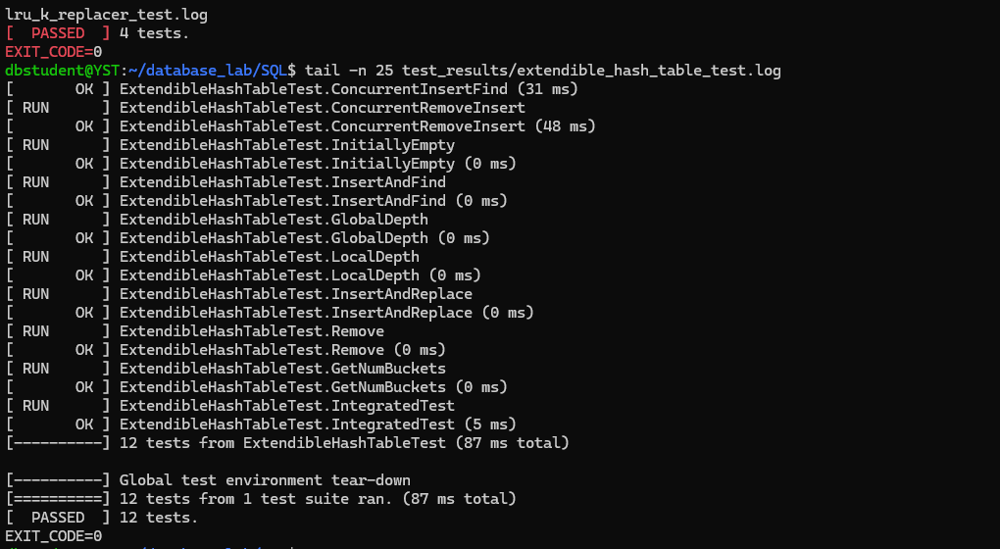
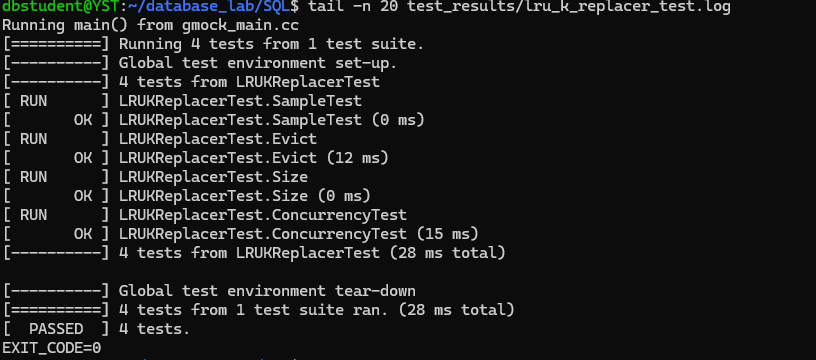
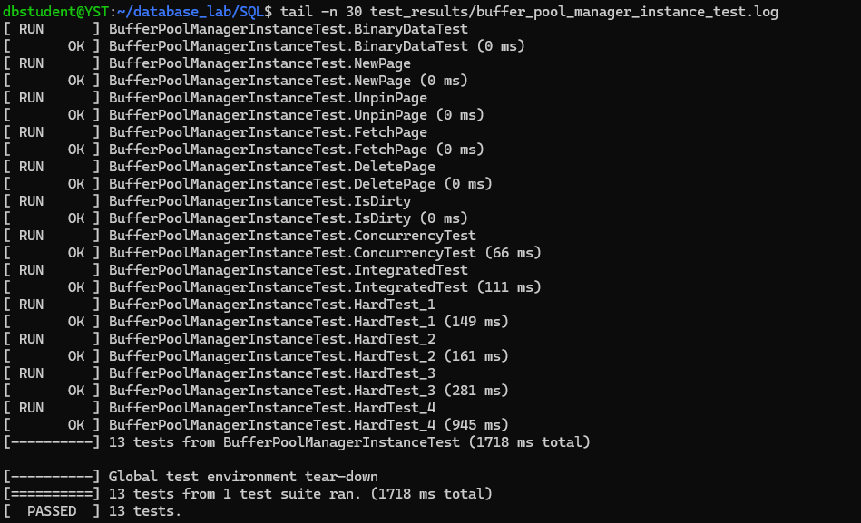

# SQL 数据库实验

基于 CMU BusTub 的数据库实验源码，包含当前完成的实验一（Project 1）实现。

## 一、实验内容

本实验主要完成数据库缓冲池管理相关的三个核心模块：

- **可扩展哈希表（Extendible Hash Table）**：实现键值存储、查询、删除、动态桶分裂与目录扩展。
- **LRU-K 页面替换器（LRU-K Replacer）**：根据页面访问历史和后向 K 距离确定缓存淘汰顺序。
- **缓冲池管理器（Buffer Pool Manager Instance）**：实现页面创建、获取、释放、删除、脏页写回及缓存替换。

三个模块共同构成数据库缓冲池管理的基础。

## 二、实验测试结果

### 2.1 测试环境

- 操作系统：Windows + WSL2 / Ubuntu 22.04
- 编译器：Clang 14
- 构建工具：CMake
- 编程语言：C++17
- 测试框架：GoogleTest
- 构建模式：Debug + AddressSanitizer

### 2.2 功能测试结果

对三个核心模块分别运行单元测试，结果如下：

| 测试模块 | 测试数量 | 通过数量 | 结果 |
|---|---:|---:|---|
| Extendible Hash Table | 12 | 12 | PASS |
| LRU-K Replacer | 4 | 4 | PASS |
| Buffer Pool Manager | 13 | 13 | PASS |
| **合计** | **29** | **29** | **全部通过** |

测试结果：29 项测试全部通过，未发现失败用例。

测试覆盖哈希表插入、查询、删除、桶分裂、页面替换、缓冲池操作、并发访问及综合测试场景。

### 2.3 实际运行截图

**（1）可扩展哈希表测试**

共执行 12 项测试，全部通过。



**（2）LRU-K 页面替换器测试**

共执行 4 项测试，全部通过。



**（3）缓冲池管理器测试**

共执行 13 项测试，全部通过。



## 三、构建与测试

### 3.1 环境依赖

当前开发环境为 WSL2 / Ubuntu 22.04，使用 Clang 14、CMake 和 Python 3。

首次运行需安装项目依赖，可参考：

`build_support/packages.sh`

### 3.2 编译项目

在项目根目录执行：

```bash
bash ./build_experiment.sh --target extendible_hash_table_test lru_k_replacer_test buffer_pool_manager_instance_test
```

构建脚本采用 Debug 模式、AddressSanitizer 和 4 个并行编译任务。

### 3.3 运行单元测试

**可扩展哈希表：**

```bash
./build/test/extendible_hash_table_test --gtest_also_run_disabled_tests
```

**LRU-K 页面替换器：**

```bash
./build/test/lru_k_replacer_test --gtest_also_run_disabled_tests
```

**缓冲池管理器：**

```bash
./build/test/buffer_pool_manager_instance_test --gtest_also_run_disabled_tests
```

### 3.4 静态代码检查

执行实验一专用的 clang-tidy 检查：

```bash
cmake --build build --target check-clang-tidy-p1
```

仓库原有记录显示该检查已通过。

## 四、核心实现说明

### 4.1 可扩展哈希表

采用全局深度与局部深度管理哈希目录，通过桶分裂与目录扩展动态调整存储容量，并使用互斥锁保护并发访问。

核心文件：

`src/container/hash/extendible_hash_table.cpp`

### 4.2 LRU-K 页面替换器

维护页面最近 K 次访问的时间戳，根据后向 K 距离选择淘汰对象，并区分可淘汰与不可淘汰的页面。

核心文件：

`src/buffer/lru_k_replacer.cpp`

### 4.3 缓冲池管理器

通过哈希表管理页面与内存帧的映射关系，结合 LRU-K 替换策略，实现页面分配、磁盘读取、引用计数管理及脏页写回。

核心文件：

`src/buffer/buffer_pool_manager_instance.cpp`

## 五、仓库内容

本仓库包含 BusTub 项目源码、测试程序、第三方依赖及构建脚本。

- `src/`：数据库系统核心源码
- `test/`：单元测试代码
- `third_party/`：第三方依赖
- `build_support/`：构建辅助工具
- `docs/screenshots/`：实验运行结果截图
- `build_experiment.sh`：实验构建脚本

编译产物、本机编辑器配置、教程 PDF 及单独提供的参考代码未上传。

保留上游项目的 `LICENSE` 及源码版权声明。

## 六、完成情况

目前已完成 BusTub Project 1 的三个核心模块，实现代码已通过 29 项单元测试。

其他实验尚未在本次工作中完成或验证。
